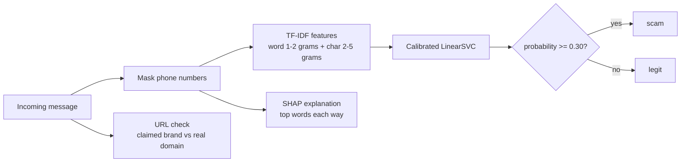

# RokoSMS

A scam detector for Roman Urdu SMS and WhatsApp messages in Pakistan.

Paste in a suspicious message and RokoSMS returns a verdict (`scam` or `legit`), a probability, the words that pushed the decision each way, and a separate check on whether any link in the message really belongs to the bank or service it claims to be from.

```text
$ python -m rokosms "Your HBL account is suspended. Verify at hbl.com.fake-login.info"
{
  "label": "scam",
  "probability": 0.849,
  "toward_scam": ["com", "verify", "suspended"],
  "toward_legit": ["hbl", "login"],
  "url_check": {
    "checked": true,
    "claimed_brand": "hbl",
    "official_domain": "hbl.com",
    "actual_domain": "fake-login.info",
    "mismatch": true
  }
}
```

## Contents

- [Why this project](#why-this-project)
- [How it works](#how-it-works)
- [Results](#results)
- [Getting started](#getting-started)
- [API](#api)
- [Project structure](#project-structure)
- [Data](#data)
- [Evaluation approach](#evaluation-approach)
- [Known limitations](#known-limitations)
- [Roadmap](#roadmap)

## Why this project

Scam texts in Pakistan (fake bank alerts, "BISP" prize messages, FBR account-freeze threats, wrong-number refund requests) are usually written in Roman Urdu mixed with English, with inconsistent spelling. Most spam filters are not built for that.

The design goal is simple: **missing a scam is worse than a false alarm.** The whole evaluation is built around scam-class recall, with a minimum precision as a safety rule.

## How it works



1. **Phone masking.** In the training data, no legitimate message contained a phone number while most phishing did, so a model could simply learn "has a phone number". Every model is therefore trained and used on text with phone numbers removed.
2. **Features.** TF-IDF over word 1-2 grams and character 2-5 grams (`char_wb`), which tolerates Roman Urdu spelling variation.
3. **Model.** `LinearSVC` (`class_weight="balanced"`) wrapped in `CalibratedClassifierCV` (sigmoid, 5-fold) so it outputs a usable probability. XGBoost was trained as a comparison and lost.
4. **Threshold.** 0.30, chosen with 5-fold cross-validation grouped by message template on the training set, never on the dev set.
5. **Explanations.** SHAP values from a separate plain `LinearSVC` trained on the same masked text, filtered to words actually present in the message.
6. **URL check.** Finds the first link, follows redirects, compares its registered domain (via `tldextract`) against an official-domain whitelist of 49 Pakistani institutions. Lookalikes such as `hbl.com.fake-login.info` are caught because only the registered domain is compared, not a substring.

The URL check is a separate signal and does not change the model's label.

## Results

All figures are for the scam class (`Labels = 1`).

### Real-world check (gold set)

17 messages submitted through a Google Form, evaluated once, after every decision was fixed.

| Metric | Value |
| --- | --- |
| Scam recall | **15 / 16 = 0.938** |
| Precision | not computable (only 1 legitimate message) |

One scam was missed (a fabricated "money received" notice with no threat, link, or urgency) and the one legitimate message (a passport dispatch notice) was flagged. With n = 17 this is a directional signal, not a confident estimate; the 95% interval on 15/16 is roughly 70% to 100%.

### Model comparison (training-set CV and dev set)

| Model | Text | CV recall | CV precision | CV F2 | CV PR-AUC | Dev recall | Dev precision |
| --- | --- | --- | --- | --- | --- | --- | --- |
| LinearSVC | normal | 0.995 | 0.990 | 0.994 | 1.000 | 1.000 | 1.000 |
| LinearSVC | phone-masked | 0.995 | 0.994 | 0.995 | 1.000 | 1.000 | 1.000 |
| XGBoost | normal | 0.952 | 0.984 | 0.959 | 0.997 | 0.966 | 1.000 |
| XGBoost | phone-masked | 0.910 | 0.950 | 0.917 | 0.987 | 0.966 | 1.000 |

Masking phone numbers does not hurt LinearSVC but costs XGBoost about four points of recall, which is why LinearSVC was chosen.

> **Read these numbers carefully.** Most of the training and dev data is template-based, so CV and dev scores are much higher than real-world performance will be. Only the gold-set figures above should be read as a real-world signal.

Raw results are in [`reports/`](reports/).

## Getting started

Requires Python 3.9 or newer. The saved model was produced with scikit-learn 1.9.1; using the same version avoids unpickling warnings.

```bash
git clone <your-repo-url>
cd rokosms

python -m venv .venv
source .venv/bin/activate        # Windows: .venv\Scripts\activate

pip install -r requirements.txt
pip install -e .
```

Run everything from the project root: the model path (`models/rokosms_v1.joblib`) is relative.

### Classify a message from the command line

```bash
python -m rokosms "Mubarak ho! BISP main apka 50,000 ka inam lga ha. Apna pin is number par send krin."
```

The first call is slower than later ones because the SHAP explainer is fitted on first use.

### Run the API

```bash
uvicorn api:app --reload --port 8000
```

### Run with Docker

```bash
docker build -t rokosms .
docker run -p 8000:8000 rokosms
```

### Run the web frontend

```bash
cd Frontend/RokoSMS-frontend
npm install
npm run dev
```

The frontend reads the API address from `VITE_API_URL` in `Frontend/RokoSMS-frontend/.env`. Point it at `http://localhost:8000` for local use.

### Run the tests

```bash
pytest
```

### Reproduce training and evaluation

```bash
python -m scripts.train              # CV + dev scores for both models, normal and phone-masked
python -m scripts.tune_threshold     # grouped-CV threshold table
python scripts/save_model.py         # writes models/rokosms_v1.joblib
python scripts/eval_gold.py          # gold-set evaluation (run once)
```

## API

### `GET /`

Health check.

```json
{ "status": "RokoSMS API is running" }
```

### `POST /predict`

```bash
curl -X POST http://localhost:8000/predict \
  -H "Content-Type: application/json" \
  -d '{"text": "FBR ki taraf se apka account freeze kr dia gya ha. OTP sms karin."}'
```

| Field | Meaning |
| --- | --- |
| `label` | `"scam"` or `"legit"`, using the 0.30 threshold |
| `probability` | Calibrated probability that the message is a scam |
| `toward_scam` | Up to 3 words or phrases that pushed toward scam |
| `toward_legit` | Up to 3 words or phrases that pushed toward legit |
| `url_check` | Result of the link check, or `{"checked": false, "reason": ...}` when there is no link, no recognised brand, or the brand is not on the whitelist |

When `url_check.checked` is true it also contains `claimed_brand`, `official_domain`, `actual_domain`, and `mismatch`.

## Project structure

```text
rokosms/
├── api.py                     FastAPI app (GET /, POST /predict)
├── Dockerfile
├── pyproject.toml
├── requirements.txt
├── src/rokosms/
│   ├── text_utils.py          spelling normalisation, templating, phone masking, brand list
│   ├── features.py            TF-IDF feature union
│   ├── models.py              model builders and DECISION_THRESHOLD
│   ├── data.py                dataset loaders
│   ├── predict.py             end-to-end prediction used by the CLI and API
│   ├── explain.py             SHAP explanations
│   ├── url_check.py           link vs. claimed-brand check
│   └── __main__.py            command-line entry point
├── scripts/
│   ├── data_build/            cleaning, templating, dataset assembly, grouped split
│   ├── train.py               CV + dev scoring for all models
│   ├── tune_threshold.py      threshold selection by grouped CV
│   ├── save_model.py          fit and save the final model
│   ├── build_gold_set.py      turn Google Form export into the gold set
│   ├── eval_gold.py           one-time gold-set evaluation
│   └── ...                    shortcut checks and other diagnostics
├── data/
│   ├── raw/                   seed templates, synthetic templates, institution whitelist
│   ├── processed/             master pool, train and dev splits
│   └── gold/                  gold set
├── models/                    saved model artifact
├── reports/                   EVAL_PLAN.txt, baseline results, gold results
├── tests/
└── Frontend/RokoSMS-frontend/ React + Vite interface
```

## Data

| Part | Rows | Notes |
| --- | --- | --- |
| Found messages | 221 | Deduplicated from a 1,000-row dataset (164 scam, 57 legitimate). That dataset is itself template-generated. |
| Synthetic messages | 1,430 | 371 templates generated from the seed set with an LLM and then validated; each was filled in with code (not by the LLM). 752 scam, 678 legitimate. |
| **Master pool** | **1,651** | Split by template into train (1,418) and dev (233) with zero template overlap. |
| Gold set | 17 | Real messages from a Google Form (16 scam, 1 legitimate). Never used for training or tuning. |

Scam types covered: account block threats, reward and lottery scams, government scheme scams (BISP and similar), account hack warnings, FBR account freezes, wrong-number refund scams, and ATM card suspension links. Legitimate types: bank OTPs, deposits, ATM alerts, tax deductions, salary credits, wallet transfers, utility bills, and traffic challans.

Splitting by template matters: if several filled-in copies of one template were spread across train and dev, the dev score would reward memorisation.

## Evaluation approach

The evaluation plan ([`reports/EVAL_PLAN.txt`](reports/EVAL_PLAN.txt)) was written before training and is append-only. Changes are recorded as dated notes instead of edits.

- **Main metric:** recall on the scam class.
- **Safety rule:** scam-class precision must stay at or above 0.90.
- **Also reported:** F2, PR-AUC, confusion matrix, split by real and synthetic messages.
- **Data roles:** train for fitting and grouped cross-validation; dev for quick checks only; gold set once, at the end.
- **Threshold:** chosen on train with grouped CV, never on dev.

The log also records the problems found along the way: the phone-number shortcut, a substring bug in the URL checker, and an explainer bug that gave values to absent words.

## Known limitations

- **Templated data inflates scores.** CV and dev numbers overstate real performance.
- **Gold set is tiny and lopsided.** 17 messages with a single legitimate example, so precision on real data is unmeasured.
- **Fabricated-fact scams.** A scam that reads like a normal deposit notification (no threat, no link) is undetectable from wording alone.
- **Unfamiliar legitimate categories.** A government passport notice, a category absent from training, was flagged as a scam.
- **Link-based phishing.** Few training messages contain links, so the model leans on the separate URL check for this pattern.
- **Network dependency.** The URL check makes a live request (5-second timeout) to follow redirects; if it fails, the link as written is used.
- **Whitelist coverage.** The URL check only runs for brands in the 49-institution whitelist.

## Roadmap

- Collect many more real legitimate messages so precision can be measured on real data.
- Add signals from outside the message text (sender ID, user transaction history) for fabricated-fact scams.
- Add legitimate categories such as government notices to the training data.
- Pin dependency versions and add a lock file.
- Retrain and re-evaluate on a larger gold set, with the plan updated by dated notes.
